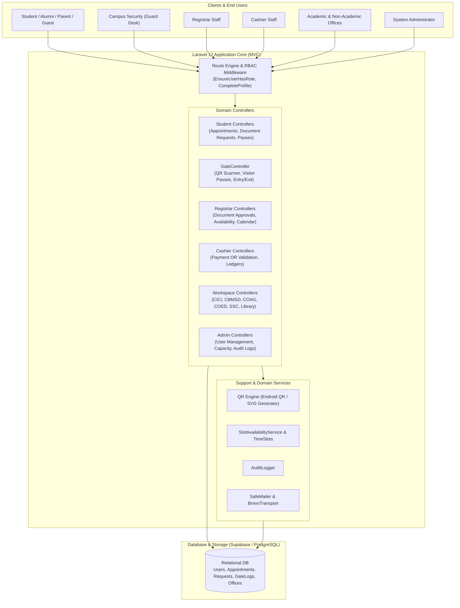
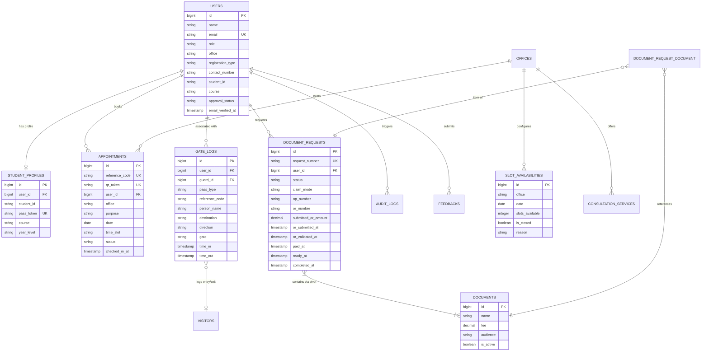

# ISUFSTPASS — System Source Code & Architecture Appendix
**Iloilo State University of Fisheries Science and Technology Pass & Online Transaction System**  
*Academic Year: 2026–2027 | Capstone / Thesis Technical Documentation Appendix*

---

## Table of Contents
1. [System Overview & Technical Architecture](#1-system-overview--technical-architecture)
2. [Codebase Directory Structure](#2-codebase-directory-structure)
3. [Database Schema & Entity-Relationship Architecture](#3-database-schema--entity-relationship-architecture)
4. [Routing & Role-Based Access Control Architecture](#4-routing--role-based-access-control-architecture)
5. [Core Enumerations (Enums)](#5-core-enumerations-enums)
6. [Core Eloquent Models & Business Rules](#6-core-eloquent-models--business-rules)
7. [Core Controller Implementations](#7-core-controller-implementations)
8. [Domain Support Services & Security Engine](#8-domain-support-services--security-engine)
9. [Deployment & Environment Configuration](#9-deployment--environment-configuration)

---

## 1. System Overview & Technical Architecture

**ISUFSTPASS** is an integrated web-based campus pass, online office appointment scheduling, document request processing, cashier ledger tracking, and campus security gate-scan system developed for the Iloilo State University of Fisheries Science and Technology (ISUFST).

### 1.1 Core Technology Stack
- **Framework & Backend:** Laravel 12.x / PHP 8.2+
- **Frontend Layer:** Blade Templating Engine, Tailwind CSS v3.x, Alpine.js, Vite build tooling
- **Database Layer:** PostgreSQL (Supabase cloud hosting) / MySQL compatibility via Eloquent ORM
- **Security & Identification:** Dynamic Endroid SVG QR Code generation, HTML5 client-side camera scanning, Role-Based Access Control (RBAC) middleware
- **Notifications & Mail:** Brevo SMTP & Resend API with custom `SafeMailer` fallback, Laravel database notifications

### 1.2 High-Level Architecture Diagram



---

## 2. Codebase Directory Structure

```text
ISUFSTPASS/
├── app/
│   ├── Console/Commands/        # CLI commands (GenerateIcons, TestMail)
│   ├── Enums/                   # Strict PHP 8 Enums for domain constants
│   │   ├── AppointmentStatus.php
│   │   ├── ClaimMode.php
│   │   ├── DocumentRequestStatus.php
│   │   ├── EducationalLevel.php
│   │   ├── EducationalStatus.php
│   │   ├── Office.php
│   │   ├── Permission.php
│   │   ├── RequestPurposeType.php
│   │   └── Role.php
│   ├── Http/
│   │   ├── Controllers/         # Specialized controller sub-namespaces
│   │   │   ├── Admin/           # Admin modules (Users, Capacities, Logs, Departments)
│   │   │   ├── Auth/            # Breeze Auth, Google OAuth, Profile Completion
│   │   │   ├── Cashier/         # Payment verification, OR logging, Ledger
│   │   │   ├── Department/      # College deaneries (CICI, CBMSD, COAG, COED)
│   │   │   ├── Guard/           # GateController (Live QR Scanner & Gate Logs)
│   │   │   ├── Offices/         # Service desks (Accounting, Library, SSC, Alumni)
│   │   │   ├── Registrar/       # Document request processing, appointment approval
│   │   │   ├── Student/         # Student passes, booking, document requests, feedback
│   │   │   └── Workspace/       # Generic office workspace & check-in handlers
│   │   ├── Middleware/          # EnsureUserHasRole, Role Verification
│   │   └── Requests/            # Form request validation classes
│   ├── Jobs/                    # Asynchronous queued workers (SendAppointmentReminders)
│   ├── Mail/                    # Mailable classes for transaction emails
│   ├── Models/                  # Eloquent entities & relationships
│   ├── Notifications/           # Database and mail alert channels
│   ├── Policies/                # Authorization policies (Appointments, Documents)
│   ├── Providers/               # AppServiceProvider & Core bindings
│   └── Support/                 # Domain helpers (SlotAvailability, CampusTime, QrUrl)
├── config/                      # Framework and package configurations
├── database/
│   ├── factories/               # Model factories for testing
│   ├── migrations/              # 45+ versioned schema migrations
│   └── seeders/                 # Database seeders for production accounts & offices
├── resources/
│   ├── css/                     # Tailwind CSS entry points
│   ├── js/                      # JavaScript, HTML5 QR camera scanner integration
│   └── views/                   # Blade templates categorized by role
│       ├── admin/
│       ├── cashier/
│       ├── guard/
│       ├── registrar/
│       ├── student/
│       └── workspace/
├── routes/
│   ├── web.php                  # Primary application routes & role dashboards
│   ├── auth.php                 # Authentication & password management endpoints
│   └── console.php              # Scheduled commands & cron tasks
└── public/                      # Public document assets, icons, compiled bundles
```

---

## 3. Database Schema & Entity-Relationship Architecture

### 3.1 Entity Relationship Diagram



### 3.2 Key Database Tables Specifications

#### `users` Table
Stores authenticated campus actors, encompassing students, alumni, parents, guards, office staff, registrars, cashiers, and administrators.
- `id` (BigIncrements, PK)
- `name` / `first_name`, `middle_name`, `last_name` (String)
- `email` (String, Unique)
- `role` (Enum: `admin`, `registrar`, `cashier`, `student`, `department`, `office`, `guard`)
- `office` (Nullable String: Key for designated campus office or academic department)
- `registration_type` (Enum: `student`, `alumni`, `parent`, `guardian`, `guest`)
- `approval_status` (Enum: `pending`, `approved`, `rejected`)
- `student_id`, `course`, `year_graduated`, `contact_number` (String, Nullable)
- `avatar_data` (LongText: Base64 profile photo data for gate visual confirmation)

#### `appointments` Table
Tracks real-time appointments across academic departments and administrative offices.
- `id` (BigIncrements, PK)
- `reference_code` (String 12, Unique: Public identifier, e.g., `APT-20261027-ABC123`)
- `qr_token` (String 64, Unique: High-entropy cryptographic token encoded in appointment pass QR)
- `user_id` (BigInteger FK -> `users.id`)
- `office` (String: Designated office destination)
- `purpose` (String: Description or consultation category)
- `date` (Date: Scheduled visit date)
- `time_slot` (String: E.g., `09:00 AM - 10:00 AM`)
- `status` (Enum: `pending`, `confirmed`, `completed`, `cancelled`, `rejected`)
- `checked_in_at` (Timestamp, Nullable: Recorded when user scans or checks in at destination office)

#### `document_requests` & `documents` Tables
Manages official registrar documents (Certificates of Grades, Transcript of Records, Honorable Dismissals).
- `request_number` (String, Unique: E.g., `REQ-20261027-XYZ890`)
- `status` (Enum: `pending`, `payment_pending`, `paid`, `processing`, `for_signature`, `ready_for_pickup`, `completed`, `cancelled`, `rejected`)
- `claim_mode` (Enum: `pickup`, `representative`, `courier`)
- `op_number` (String, Nullable: Order of Payment number assigned by Registrar)
- `or_number` / `submitted_or_number` (String, Nullable: Official Receipt issued upon payment)
- `submitted_or_amount` (Decimal 10,2: Official amount deposited at cashier)
- `or_validated_at` (Timestamp: Cashier verification seal)

#### `gate_logs` Table
Maintains legal audit logs for campus physical security, entry, and egress.
- `user_id` (BigInteger, Nullable FK -> `users.id`)
- `guard_id` (BigInteger FK -> `users.id`: Attributed security guard on duty)
- `pass_type` (Enum: `digital_id`, `appointment_pass`, `claim_pass`, `visitor_pass`)
- `reference_code` (String: Cross-references appointment, claim, or visitor record)
- `person_name`, `destination`, `purpose` (String: Identifying metadata)
- `direction` (Enum: `in`, `out`)
- `time_in` / `time_out` (Timestamps: Pair-tracked ingress and egress)
- `gate` (String: Physical entry point name)

---

## 4. Routing & Role-Based Access Control Architecture

The application enforces strict separation of privileges through route groups protected by the `auth`, `verified`, and `EnsureUserHasRole` middleware.

### 4.1 Route Matrix Summary

| URL Pattern | Primary Controller | Allowed Roles | Description |
|---|---|---|---|
| `/` | `Closure` | Public | University landing page & contact information |
| `/login`, `/register` | Auth Controllers | Guest | Account authentication & role-specific registration |
| `/complete-profile` | `CompleteProfileController` | Auth (Unfinished) | Mandatory contact & student detail submission |
| `/dashboard` | `web.php (Dispatcher)` | Authenticated | Dynamic dispatcher directing users to role dashboards |
| `/appointments/**` | `Student\AppointmentController` | Student, Alumni, Parent | Booking, viewing, and cancelling office appointments |
| `/requests/**` | `Student\DocumentRequestController`| Student, Alumni | Submitting registrar requests & uploading OR proofs |
| `/pass` | `Student\PassController` | Student, Alumni | Generates Digital Student ID & Gate Pass QR |
| `/guard/**` | `Guard\GateController` | `guard`, `admin` | Real-time gate camera scanner & manual pass validation |
| `/registrar/appointments/**`| `Registrar\AppointmentController`| `registrar`, `admin` | Calendar schedule management, approvals, capacity |
| `/registrar/requests/**` | `Registrar\DocumentRequestController`| `registrar`, `admin` | Multi-step request workflow (Op, Signature, Pickup) |
| `/cashier/payments/**` | `Cashier\PaymentController` | `cashier`, `admin` | Verifying student OR submissions & receipting |
| `/cici/**`, `/cbmsd/**` | `OfficeWorkspaceController` | Office Staff, Admin | Department-specific consultation triage & check-in |
| `/admin/users/**` | `Admin\UserController` | `admin` | System user CRUD, approvals, role allocations |
| `/admin/audit-logs` | `Admin\AuditLogController` | `admin` | System-wide immutable security audit log review |

---

## 5. Core Enumerations (Enums)

Using PHP 8.2 Backed Enums guarantees compile-time type safety across database queries and view components.

### 5.1 Role Enumeration (`app/Enums/Role.php`)
```php
namespace App\Enums;

enum Role: string
{
    case ADMIN = 'admin';
    case REGISTRAR = 'registrar';
    case CASHIER = 'cashier';
    case STUDENT = 'student';
    case DEPARTMENT = 'department';
    case OFFICE = 'office';
    case GUARD = 'guard';

    public function label(): string
    {
        return match ($this) {
            self::ADMIN => 'System Administrator',
            self::REGISTRAR => 'Registrar Staff',
            self::CASHIER => 'Cashier Staff',
            self::STUDENT => 'Student / Client',
            self::DEPARTMENT => 'Academic Department',
            self::OFFICE => 'Administrative Office',
            self::GUARD => 'Campus Security Desk',
        };
    }
}
```

### 5.2 Appointment & Request Status Enums
```php
namespace App\Enums;

enum AppointmentStatus: string
{
    case PENDING = 'pending';
    case CONFIRMED = 'confirmed';
    case COMPLETED = 'completed';
    case CANCELLED = 'cancelled';
    case REJECTED = 'rejected';
}

enum DocumentRequestStatus: string
{
    case PENDING = 'pending';
    case PAYMENT_PENDING = 'payment_pending';
    case PAID = 'paid';
    case PROCESSING = 'processing';
    case FOR_SIGNATURE = 'for_signature';
    case READY_FOR_PICKUP = 'ready_for_pickup';
    case COMPLETED = 'completed';
    case CANCELLED = 'cancelled';
    case REJECTED = 'rejected';
}
```

---

## 6. Core Eloquent Models & Business Rules

### 6.1 User Model (`app/Models/User.php`)
The `User` model handles identity, role-specific attributes, profile avatar encoding, and access checks.

```php
namespace App\Models;

use App\Enums\Role;
use App\Models\Concerns\HasAvatarUrl;
use Illuminate\Contracts\Auth\MustVerifyEmail;
use Illuminate\Database\Eloquent\Relations\HasMany;
use Illuminate\Database\Eloquent\Relations\HasOne;
use Illuminate\Foundation\Auth\User as Authenticatable;
use Illuminate\Notifications\Notifiable;

class User extends Authenticatable implements MustVerifyEmail
{
    use HasAvatarUrl, Notifiable;

    public const ROLE_ADMIN = 'admin';
    public const ROLE_REGISTRAR = 'registrar';
    public const ROLE_CASHIER = 'cashier';
    public const ROLE_STUDENT = 'student';
    public const ROLE_GUARD = 'guard';

    protected $fillable = [
        'name', 'first_name', 'middle_name', 'last_name',
        'email', 'email_verified_at', 'role', 'office',
        'registration_type', 'contact_number', 'student_id',
        'course', 'password', 'approval_status', 'avatar_data'
    ];

    public function studentProfile(): HasOne
    {
        return $this->hasOne(StudentProfile::class);
    }

    public function appointments(): HasMany
    {
        return $this->hasMany(Appointment::class);
    }

    public function documentRequests(): HasMany
    {
        return $this->hasMany(DocumentRequest::class);
    }

    public function isStudent(): bool
    {
        return in_array($this->role, [self::ROLE_STUDENT, null], true);
    }

    public function requiresProfileCompletion(): bool
    {
        // Enforces full demographic capture for registered clients
        if (in_array($this->role, [self::ROLE_ADMIN, self::ROLE_REGISTRAR, self::ROLE_CASHIER, self::ROLE_GUARD])) {
            return false;
        }
        return empty($this->contact_number);
    }
}
```

### 6.2 Appointment Model (`app/Models/Appointment.php`)
Manages appointment reference numbering, high-resolution SVG QR code generation, and daily slot counting.

```php
namespace App\Models;

use App\Enums\AppointmentStatus;
use App\Support\QrUrl;
use Endroid\QrCode\QrCode;
use Endroid\QrCode\Writer\SvgWriter;
use Illuminate\Database\Eloquent\Model;
use Illuminate\Database\Eloquent\Relations\BelongsTo;
use Illuminate\Support\Str;

class Appointment extends Model
{
    protected $fillable = [
        'reference_code', 'qr_token', 'user_id', 'office',
        'purpose', 'date', 'time_slot', 'status', 'checked_in_at'
    ];

    protected static function booted(): void
    {
        static::creating(function (Appointment $appointment) {
            if (empty($appointment->reference_code)) {
                $appointment->reference_code = 'APT-' . now()->format('Ymd') . '-' . Str::upper(Str::random(6));
            }
            if (empty($appointment->qr_token)) {
                $appointment->qr_token = Str::random(40);
            }
            if (empty($appointment->status)) {
                $appointment->status = AppointmentStatus::PENDING->value;
            }
        });
    }

    public function user(): BelongsTo
    {
        return $this->belongsTo(User::class);
    }

    /**
     * Renders standalone inline SVG representation of the Appointment verification pass.
     */
    public function qrCodeSvg(int $size = 220): string
    {
        $url = QrUrl::appointment($this->qr_token);
        $qrCode = new QrCode($url);
        $writer = new SvgWriter();
        return $writer->write($qrCode)->getString();
    }
}
```

---

## 7. Core Controller Implementations

### 7.1 Guard Gate Controller (`app/Http/Controllers/Guard/GateController.php`)
Performs instant token parsing during camera or barcode scans, logs ingress/egress, and calculates current on-campus headcount.

```php
namespace App\Http\Controllers\Guard;

use App\Http\Controllers\Controller;
use App\Models\Appointment;
use App\Models\GateLog;
use App\Models\StudentProfile;
use App\Models\Visitor;
use App\Support\GateLogList;
use Illuminate\Http\JsonResponse;
use Illuminate\Http\Request;
use Illuminate\Support\Facades\Auth;

class GateController extends Controller
{
    public function dashboard(Request $request)
    {
        $search = trim((string) $request->query('q', ''));
        return view('guard.dashboard', [
            'gateName' => 'Main Gate Desk',
            'logs' => GateLogList::today($search),
            'insideCount' => GateLogList::insideCount(),
            'todayCount' => GateLogList::todayCount(),
        ]);
    }

    public function scan(Request $request): JsonResponse
    {
        $token = trim((string) $request->input('token'));
        
        // 1. Check if token corresponds to a Student Digital ID Pass
        $profile = StudentProfile::with('user')->where('pass_token', $token)->first();
        if ($profile) {
            return $this->handleGateEntryExit($profile->user, 'digital_id', $profile->user->name, 'Student Campus Pass');
        }

        // 2. Check if token matches an Approved Appointment Pass
        $appointment = Appointment::with('user')->where('qr_token', $token)->first();
        if ($appointment) {
            return $this->handleGateEntryExit(
                $appointment->user,
                'appointment_pass',
                $appointment->user->name,
                "Appointment: {$appointment->office}"
            );
        }

        return response()->json(['valid' => false, 'message' => 'Unrecognized or invalid QR pass.'], 404);
    }

    protected function handleGateEntryExit($user, string $passType, string $personName, string $destination): JsonResponse
    {
        $now = now();
        $openLog = GateLog::where('user_id', $user->id)
            ->whereDate('time_in', $now->toDateString())
            ->whereNull('time_out')
            ->latest('time_in')
            ->first();

        if ($openLog) {
            // Close session: Mark exit
            $openLog->update(['time_out' => $now, 'direction' => 'out']);
            return response()->json([
                'valid' => true,
                'action' => 'exit',
                'name' => $personName,
                'message' => "Exit logged successfully for {$personName}."
            ]);
        }

        // Open session: Mark entry
        GateLog::create([
            'user_id' => $user->id,
            'guard_id' => Auth::id(),
            'pass_type' => $passType,
            'person_name' => $personName,
            'destination' => $destination,
            'direction' => 'in',
            'gate' => 'Main Campus Gate',
            'time_in' => $now,
            'scanned_at' => $now,
        ]);

        return response()->json([
            'valid' => true,
            'action' => 'entry',
            'name' => $personName,
            'message' => "Welcome to ISUFST! Entry logged for {$personName}."
        ]);
    }
}
```

### 7.2 Cashier Payment & OR Validation Controller (`app/Http/Controllers/Cashier/PaymentController.php`)
Allows the cashier to audit payment claims made by students and issue authenticated Official Receipts (ORs).

```php
namespace App\Http\Controllers\Cashier;

use App\Enums\DocumentRequestStatus;
use App\Http\Controllers\Controller;
use App\Models\DocumentRequest;
use App\Support\AuditLogger;
use Illuminate\Http\RedirectResponse;
use Illuminate\Http\Request;

class PaymentController extends Controller
{
    public function validatePayment(Request $request, DocumentRequest $documentRequest): RedirectResponse
    {
        $validated = $request->validate([
            'or_number' => ['required', 'string', 'max:50'],
            'amount_paid' => ['required', 'numeric', 'min:0'],
            'remarks' => ['nullable', 'string', 'max:255'],
        ]);

        $documentRequest->update([
            'or_number' => $validated['or_number'],
            'submitted_or_amount' => $validated['amount_paid'],
            'paid_at' => now(),
            'or_validated_at' => now(),
            'status' => DocumentRequestStatus::PROCESSING->value,
            'or_validation_note' => $validated['remarks'] ?? 'Verified by Cashier Office',
        ]);

        AuditLogger::log('payment_verified', "OR #{$validated['or_number']} verified for {$documentRequest->request_number}");

        return back()->with('status', "Payment validated. Request is now in processing.");
    }
}
```

---

## 8. Domain Support Services & Security Engine

### 8.1 Campus Operating Hours & Slot Availability (`app/Support/SlotAvailabilityService.php`)
Calculates slot quotas dynamically, disallowing bookings on non-working days, weekends, holidays, or capped schedules.

```php
namespace App\Support;

use App\Models\Appointment;
use App\Models\SlotAvailability;
use Carbon\Carbon;

class SlotAvailabilityService
{
    /**
     * Determines whether a given office is open for booking on a specific date.
     */
    public static function isDateAvailable(string $office, Carbon $date): bool
    {
        if ($date->isWeekend()) {
            return false;
        }

        $custom = SlotAvailability::where('office', $office)
            ->whereDate('date', $date->toDateString())
            ->first();

        if ($custom && $custom->is_closed) {
            return false;
        }

        $limit = $custom ? $custom->slots_available : Appointment::SLOTS_PER_DAY;
        $booked = Appointment::where('office', $office)
            ->whereDate('date', $date->toDateString())
            ->whereNotIn('status', ['cancelled', 'rejected'])
            ->count();

        return $booked < $limit;
    }
}
```

### 8.2 Audit Logger Service (`app/Support/AuditLogger.php`)
Records chronological events for accountability across student, registrar, guard, and administrator operations.

```php
namespace App\Support;

use App\Models\AuditLog;
use Illuminate\Support\Facades\Auth;
use Illuminate\Support\Facades\Request;

class AuditLogger
{
    public static function log(string $action, string $description, ?string $targetType = null, ?int $targetId = null): void
    {
        AuditLog::create([
            'user_id' => Auth::id(),
            'action' => $action,
            'description' => $description,
            'target_type' => $targetType,
            'target_id' => $targetId,
            'ip_address' => Request::ip(),
            'user_agent' => Request::userAgent(),
        ]);
    }
}
```

---

## 9. Deployment & Environment Configuration

### 9.1 Environment Configuration (`.env.example`)
```ini
APP_NAME=ISUFSTPASS
APP_ENV=production
APP_KEY=base64:GENERATE_KEY_HERE
APP_DEBUG=false
APP_URL=https://isufstpass.isufst.edu.ph

# Database Connection (PostgreSQL / Supabase)
DB_CONNECTION=pgsql
DB_HOST=aws-0-ap-southeast-1.pooler.supabase.com
DB_PORT=6543
DB_DATABASE=postgres
DB_USERNAME=postgres.YOUR_PROJECT_ID
DB_PASSWORD=YOUR_DB_PASSWORD

# Mail Service (Brevo / SMTP)
MAIL_MAILER=smtp
MAIL_HOST=smtp-relay.brevo.com
MAIL_PORT=587
MAIL_USERNAME=your_brevo_login
MAIL_PASSWORD=your_brevo_smtp_key
MAIL_ENCRYPTION=tls
MAIL_FROM_ADDRESS="no-reply@isufst.edu.ph"
MAIL_FROM_NAME="${APP_NAME}"

# Session and Cache Drivers
SESSION_DRIVER=database
CACHE_STORE=database
QUEUE_CONNECTION=database
```

### 9.2 Project Build & Provisioning Commands
```bash
# 1. Clone repository & install dependencies
composer install --no-dev --optimize-autoloader
npm install && npm run build

# 2. Key generation & database migrations
php artisan key:generate
php artisan migrate --force

# 3. Seed production offices and administrative accounts
php artisan db:seed

# 4. Storage linking & production cache optimization
php artisan storage:link
php artisan config:cache
php artisan route:cache
php artisan view:cache
```

---
*Report generated for ISUFSTPASS Capstone / Thesis Source Code & Architectural Documentation.*
